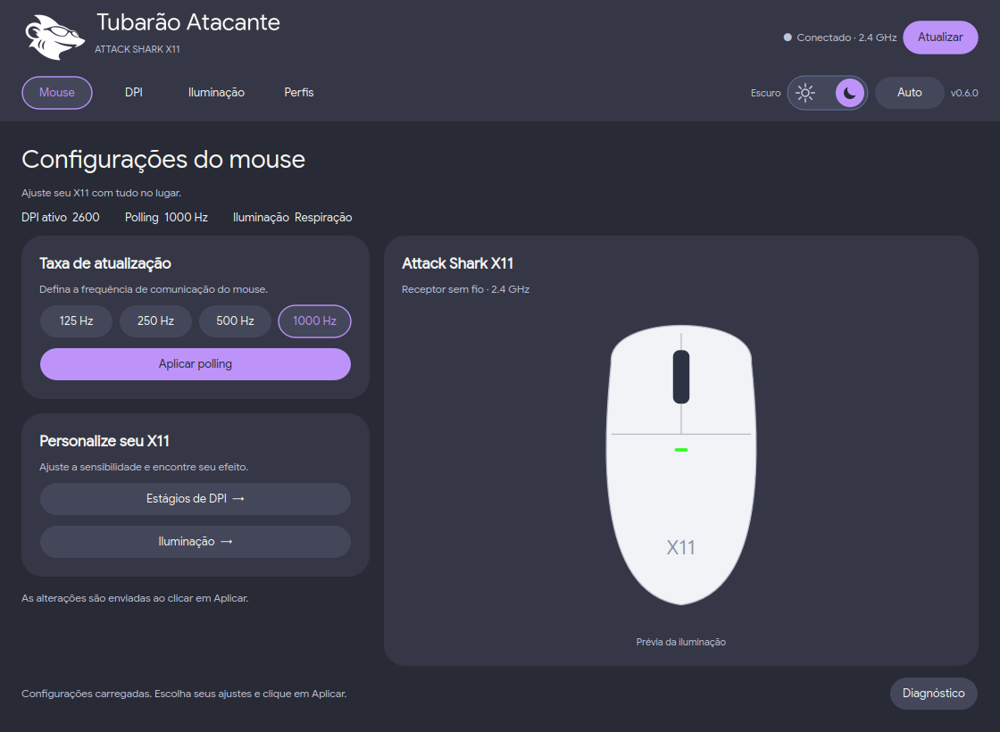

<div align="center">


# Tubarão Atacante

**Seu Attack Shark X11 no Linux.** Configurador comunitário com interface Qt 6, linguagem visual Material e tema Dracula.


[](LICENSE)
[](CONTRIBUTING.md)

[Instalação](#-instalando) · [Uso](#-usando) · [Contribuir](CONTRIBUTING.md) · [Licença](#-licença)
</div>



> Projeto independente, sem vínculo ou endosso da Attack Shark. Desenvolvido por engenharia reversa para permitir que a comunidade configure o X11 no Linux.

## Ajustes e melhorias

- [x] Consulta e aplicação de polling: 125, 250, 500 e 1000 Hz.
- [x] Seis estágios de DPI e cores por estágio.
- [x] Sete modos de iluminação, velocidade e cor global.
- [x] Perfis locais: criar, duplicar, renomear, excluir, salvar e aplicar.
- [x] Tema claro/escuro animado, modo automático e antialiasing.
- [x] Backup anterior à gravação e confirmação por releitura.
- [ ] Personalização dos botões laterais.
- [ ] Editor e controlador de macros.
- [ ] Empacotamento e testes de hardware para outras variantes.

## 💻 Pré-requisitos

- Linux; foco de validação: CachyOS/Arch.
- Python 3.10 ou superior e PySide6.
- Attack Shark X11 com receptor USB 2.4 GHz `1D57:FA60`.
- Permissão de usuário para a interface hidraw do receptor.

Bluetooth, conexão por cabo, firmware, pareamento, bateria e outros modelos não são suportados nesta versão. Dispositivos da mesma marca podem compartilhar identificadores: compatibilidade não é garantida apenas pelo VID/PID.

## 🚀 Instalando

No CachyOS/Arch:

```bash
sudo pacman -S --needed git pyside6
git clone https://github.com/Witorr/tubarao-atacante.git
cd tubarao-atacante
/usr/bin/python attack_shark_x11.py
```

O endereço acima é o destino previsto do repositório; só estará disponível após sua publicação.

Para configurar permissões em uma instalação nova:

```bash
sudo install -m 644 70-attack-shark-x11.rules /etc/udev/rules.d/70-attack-shark-x11.rules
sudo udevadm control --reload-rules
```

Desconecte e reconecte o receptor. Execute o configurador como usuário normal.

## ☕ Usando

1. Clique em **Conectar** para ler as configurações reais.
2. Ajuste DPI, polling ou iluminação na aba correspondente.
3. Clique em **Aplicar** para enviar ao mouse.
4. Em **Perfis**, salve os ajustes e use **Aplicar ao mouse** para enviar o perfil salvo.

Carregar um perfil para edição e trocar o tema não gravam ajustes no mouse. Perfis são arquivos locais, não slots extras de memória interna. Uma falha de comunicação pode deixar uma aplicação parcialmente concluída; consulte novamente antes de repetir. Não há tentativas automáticas de restauração.

Consultas pelo terminal, sem gravar ajustes:

```bash
/usr/bin/python attack_shark_x11.py status
/usr/bin/python attack_shark_x11.py lighting-status
```

Configurações locais: `~/.config/tubarao-atacante/`. Backups: `~/.local/state/attack-shark-x11/`. Os caminhos respeitam `XDG_CONFIG_HOME` e `XDG_STATE_HOME`.

### Imagem do dispositivo

A edição pública funciona com uma ilustração vetorial própria. A imagem proprietária do fabricante não acompanha o repositório. Quem já possui os recursos da instalação original pode mantê-los localmente; leia [assets/README.md](assets/README.md). Nenhum executável ou projeto Ghidra proprietário é distribuído aqui.

## 🧪 Testes

```bash
QT_QPA_PLATFORM=offscreen /usr/bin/python -m unittest discover -v
```

A suíte usa um receptor simulado. Ela não comprova o comportamento de cada variante de firmware. A interface anterior teve funções confirmadas pelo usuário em um X11; o projeto continua em desenvolvimento. A integração contínua executa os testes em Python 3.12 e 3.13.

## 📫 Contribuindo

1. Faça um fork e crie uma branch.
2. Descreva o problema e implemente uma mudança com escopo claro.
3. Execute os testes e inclua o resultado no pull request.
4. Para alterações HID, inclua evidências de protocolo e a validação necessária.

Veja [CONTRIBUTING.md](CONTRIBUTING.md), [AGENTS.md](AGENTS.md) e o [handoff para Codex](CODEX_HANDOFF.md).

## 🤝 Colaboradores e créditos

- [Witorr](https://github.com/Witorr): mantenedor e validação no dispositivo.
- [OpenSharkX11](https://github.com/clevim/OpenSharkX11): tabela de DPI usada sob MIT, com atribuição preservada no código.
- Google Sans: distribuída sob SIL Open Font License; licença em `fonts/OFL.txt`.
- [iuricode/readme-template](https://github.com/iuricode/readme-template): estrutura de apresentação e seções deste README, adaptada do exemplo de repositório. Licença preservada em `licenses/readme-template-MIT.txt`.

## 📝 Licença

O código original deste projeto e a ilustração vetorial própria são distribuídos sob [MIT](LICENSE), permitindo uso, estudo, modificação e redistribuição. Componentes de terceiros mantêm suas licenças; veja [THIRD_PARTY_NOTICES.md](THIRD_PARTY_NOTICES.md). A licença MIT não concede direitos sobre marcas e recursos proprietários da Attack Shark.
